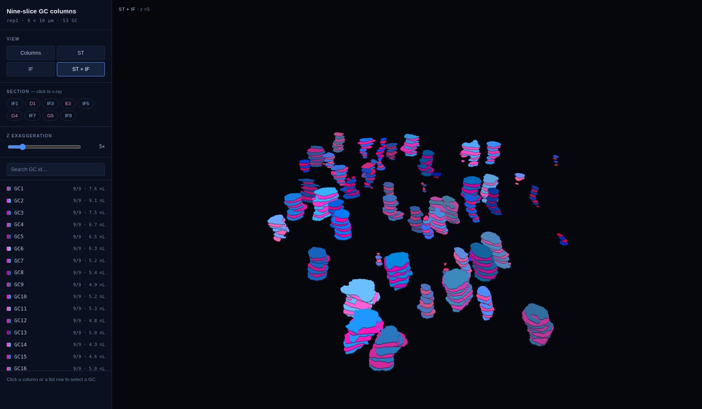
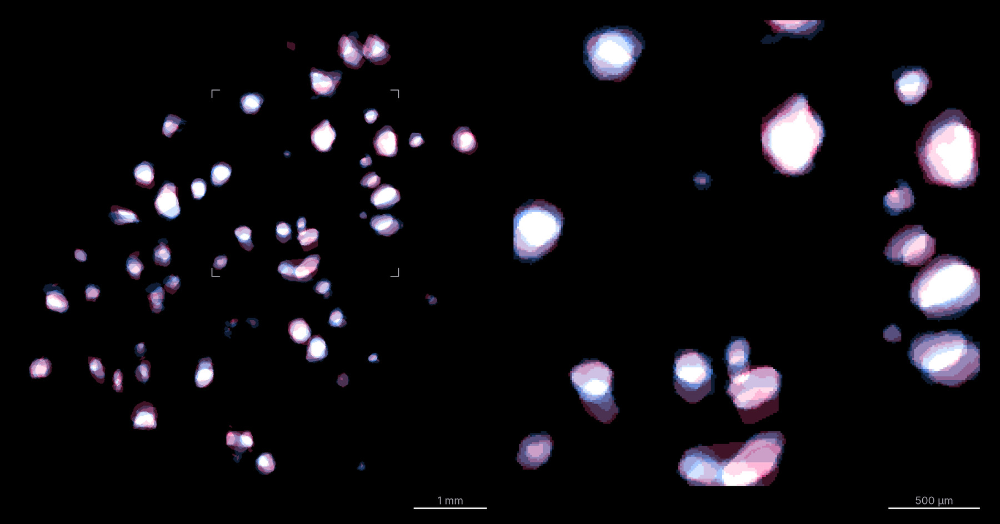
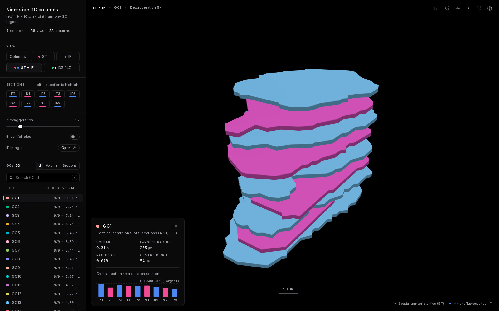

# gcalign — putting immunofluorescence and spatial transcriptomics on one ruler

You cut a block of tissue into serial sections. Some sections go to
**immunofluorescence** (IF), where you see proteins and beautiful morphology but no
transcriptome. The others go to **spatial transcriptomics** (ST — Stereo-seq here), where
you get the transcriptome but the section is consumed. Two modalities, interleaved,
never the same physical cells.

This package puts all of those sections back into **one shared coordinate system**, so a
structure that spans several sections can be followed through the whole stack and
reconstructed in 3D. It was built for germinal centres in mouse spleen, and it ships an
interactive viewer that you open in a browser.

<p align="center"></p>

---

## The problem, in plain terms

Three things make this harder than it sounds.

**1. Every section lands differently.** Each section is picked up onto a slide or a chip
by hand. It arrives rotated by an arbitrary angle, sometimes flipped over, and slightly
stretched or compressed. Nothing about the imaging tells you by how much.

**2. The two modalities measure different things.** An IF image is protein fluorescence.
An ST dataset is counts of mRNA per spot. You cannot simply overlay them and slide one
until the pixel values correlate — they are not measuring the same quantity, so there is
nothing to correlate.

**3. Adjacent sections contain different cells.** A 10 µm section and the next 10 µm
section share no cells at all. So there is no cell-to-cell correspondence to exploit,
however good your segmentation is.

## The idea: match landmarks, not cells

The way through is to stop trying to match pixels or cells, and instead match **structures
that both modalities can see independently**.

In spleen, germinal centres (GCs) are close to ideal landmarks:

- they are **discrete** — each one is a compact blob with a clear boundary;
- there are **many** of them, around 40–50 per section;
- they are **irregularly scattered**, never in a regular pattern;
- and crucially, **each modality detects them on its own terms** — GL7 protein staining on
  the IF side, and a germinal-centre transcriptional cluster on the ST side.

That irregular scatter of ~50 blobs behaves like a **constellation**. Just as a handful of
stars in an irregular pattern is enough to tell you exactly which way up a star chart
goes, a scatter of ~50 GCs is a fingerprint specific enough to pin down rotation, mirror
state and position without ambiguity.

The picture below is the whole argument in one frame. Nine consecutive sections in
cutting order; IF panels show GL7 (green) and IgD (blue), ST panels show the
transcriptional GC regions (green). Nobody has aligned anything yet — but you can already
see the same constellation of GCs in both modalities.

<p align="center"></p>

Note what we are *not* doing: we never give the IF cells an imputed transcriptome, and we
never claim a cell in one section is the same cell as one in the next. The GC pattern is
measured twice, independently, and the two measurements are compared. That keeps the
alignment and the biology from becoming circular.

## How the alignment works, step by step

### Step 0 — one side is held completely still

The ST sections are registered to each other first (we used
[Spateo](https://github.com/aristoteleo/spateo-release); any method works). From that point
on those coordinates are **frozen**. This package copies them and never moves them by even
a pixel.

This matters practically: if you have already curated GC identities on your ST data — for
example "this blob on section 2 and that blob on section 4 are the same germinal centre" —
that curation stays valid, because the frame it was defined in never changes. The IF
sections are fitted *into* that frame, not averaged with it.

### Step 1 — find the right way round

For each IF section, the pipeline tries **every** orientation: both mirror states × all
rotations in 5° steps, and for each one it slides the section over the ST section (by
Fourier cross-correlation, which tests all translations at once) and scores the result.

This is brute force on purpose. Rotation-by-180° and mirror-flip are *discrete* choices —
there is no smooth path from "flipped" to "not flipped" — so an optimiser that follows
gradients will happily settle into the wrong one. Enumerating a few hundred candidates
takes seconds and cannot get stuck.

**The candidate is then chosen by the germinal centres, not by the tissue outline.** This
turned out to be essential. A spleen section is roughly convex, so a mirrored copy of it
overlaps the original almost perfectly — in our data the wrong mirror scored a tissue
overlap of 0.928 against the correct one's 0.927, i.e. the tissue shape *preferred the
wrong answer*. Scoring by how many GC centres land within 150 µm separates them
immediately: 40 for the correct orientation versus 3–13 for the wrong ones.

A good sanity check falls out of this for free: all five IF sections in our block arrived
at the same handedness and rotations within 3° of each other, each decided independently.

### Step 2 — correct the stretch

Once a section is the right way round, the remaining error is real physical distortion —
tissue stretches and compresses as it is picked up. The pipeline pairs each IF germinal
centre with its counterpart in the ST section and fits a **thin-plate spline**: a smooth
elastic warp, like gently pressing a rubber sheet so the marked points line up, with no
sharp local pulling.

How stiff should that sheet be? Too stiff and it cannot correct the real distortion; too
floppy and it will contort itself to make every GC match perfectly, inventing agreement
that is not there. The pipeline chooses the stiffness by **leave-one-out
cross-validation**: repeatedly hide one GC, fit on the rest, and see how well the hidden
one is predicted. The setting that predicts unseen GCs best is the one that is correcting
real distortion rather than memorising noise.

In our data this moved GC centres from 25–72 µm apart down to **7–13 µm** — comfortably
sub-structure, given a GC radius around 110 µm.

### Step 3 — use both neighbours, and keep the disagreement

Every interior IF section sits between two ST sections. The pipeline aligns it to the one
before **and** to the one after, as two completely independent calculations, then averages
the two answers weighted by true z distance.

The point is not just the averaging. It is that **the difference between the two answers
is a free, honest error bar** for that section — an uncertainty estimate that costs no
extra experiment and makes no assumptions. In our data that disagreement was 32–54 µm.

Sections at the very top and bottom of the stack have a neighbour on one side only, so
their placement is less certain. The pipeline flags them rather than hiding it.

### The result

Red = ST sections, blue = IF sections, white = where they agree. Every germinal centre has
a white core with coloured fringes — the fringes are the genuine change in each GC's
cross-section from one z level to the next, which is exactly what we want to keep.

<p align="center"></p>

Once each GC carries a single identity across every section, its outlines stack into a
3D shape.

<p align="center"></p>

The surface is smoothed **in the image volume, not on the mesh**: the stack is blurred and
the surface drawn through it, which is why the sides look rounded rather than like a
nine-step staircase. The level at which the surface is drawn is solved so that the
enclosed volume reproduces the volume actually measured from the sections — so the
rounding is cosmetic and the number is not. Across 53 GCs the meshes came out within
**0.9%** of the measured voxel volume, and all 53 were watertight.

---

## Two things to be honest about

**Depth is set by your experiment, not by this software.** Nine 10 µm sections span 80 µm.
A mouse splenic GC is roughly 200–400 µm across. So our reconstructions are **the middle
slab of each GC, not a whole GC** — the columns are real, but they are not evidence about
whether GCs are spherical. If you want whole GCs, cut sections further apart (for us,
about 25 µm spacing would have done it) rather than consecutively. Run `gcalign show` and
it will print your z span so you can check this before you start.

**GC-driven alignment is a maximum-overlap atlas.** Because the germinal centres are what
drives the registration, they are nudged towards each other. That is the right choice for
*showing* 3D shape, and the wrong one for *measuring* GC volume statistically — the
measurement would partly reflect the alignment. For formal morphometry, re-run with tissue
morphology leading and the GC term down-weighted, and compare.

---

## Using it

### Install

```bash
git clone https://github.com/Reynold4k/gc-serial-align.git
cd gc-serial-align
pip install -e .
```

Needs Python 3.9+. Everything is CPU — no GPU required.

### Describe your experiment

One YAML file. The section list is the important part: write your sections in the order
you cut them and say which is which. Everything else — which ST section flanks each IF
section, the z coordinate of each plane, which sections are one-sided — is worked out for
you.

```yaml
name: my_experiment
output_dir: ./out
section_thickness_um: 10.0

sections:
  - {index: 1, kind: IF, source: 1}
  - {index: 2, kind: ST, source: D1, name: D1}
  - {index: 3, kind: IF, source: 3}
  - {index: 4, kind: ST, source: E3, name: E3}
  # ... and so on, in cutting order

if_images:
  dir: /path/to/czi/files
  um_per_px: 0.8286
  channels: {0: IgD_AF647, 1: CD4_AF594, 2: GL7_AF488, 3: DAPI}
  gc_channel: GL7_AF488          # the marker that lights up your structure
  tissue_channels: {CD4_AF594: 1.0, IgD_AF647: 0.6, GL7_AF488: 0.3}

st_scaffold:
  h5ad: /path/to/your_registered_st.h5ad
  coord_key: align_deformable    # where the registered coordinates live
  gc_id_col: gc_match_curated_final_id
```

Two complete, working examples ship with the package:
[`configs/rep1_mouse_spleen.yaml`](configs/rep1_mouse_spleen.yaml) and
[`configs/rep2_mouse_spleen.yaml`](configs/rep2_mouse_spleen.yaml). They are the same
experiment run on two biological replicates, and the differences between them are
instructive: the second replicate labels its sections with full chip ids rather than
short ones, its germinal-centre cluster has a different number and colour in its own
clustering, and one of its sections has a staining gradient that needs
`tissue_threshold_scale` turned down. All of that is config, not code.

### Run

```bash
gcalign show --config my_experiment.yaml    # check the layout before committing
gcalign run  --config my_experiment.yaml
```

About 25 minutes on one CPU core for nine sections; the orientation search is most of it.
Stages can be run separately with `--from`, `--to` or `--only` (see `gcalign stages`).

### What comes out

| | |
| --- | --- |
| `05_viewer/*.html` | the interactive viewer, one self-contained file |
| `04_columns/gc_column_metrics.csv` | per-GC volume, radius, centroid drift |
| `03_gc_match/gc_presence_9plane.csv` | which GC appears on which section |
| `02_global_align/global_transforms.json` | the transform and match quality per section |
| `validation_report.json`, `SHA256SUMS.txt` | QC numbers and checksums |

### The viewer

<p align="center"></p>

Four views (keys `1`–`4`): the GC columns on their own; the ST sections; the IF sections;
and both stacked together, alternating by modality. Click a section name to light it up
and dim the rest; click a GC to isolate it. The Z slider exaggerates depth — real scale is
1×, which for a 80 µm stack across 7 mm of tissue is almost flat, so it defaults to 5×.

Download the file and open it locally. If dragging feels sluggish it is almost always
because the browser has fallen back to software rendering — check `chrome://gpu`; viewing
over X11 forwarding from a cluster is the usual cause.

---

## Does it work outside spleen and germinal centres?

The requirement is not "germinal centres". It is: **a class of structure that is discrete,
reasonably numerous, irregularly arranged, and visible to both modalities on their own
terms.** Follicles, glomeruli, islets, tumour nests, crypts and granulomas all plausibly
qualify. Point `gc_channel` at the marker that shows your structure and `gc_id_col` at the
corresponding transcriptomic label.

It will not work on tissue with no discrete repeating landmarks, or where only one
modality can see them.

## Further reading

- [How it works — the mechanism in more detail](docs/how-it-works.md)
- [Reproducing this work from scratch](docs/reproduce-prompt.md)

## Citing

If this is useful in published work, please cite the repository and the underlying tools:
Spateo for the transcriptomics registration, scikit-image, SciPy, PyVista and Plotly.

## Licence

MIT — see [LICENSE](LICENSE).
