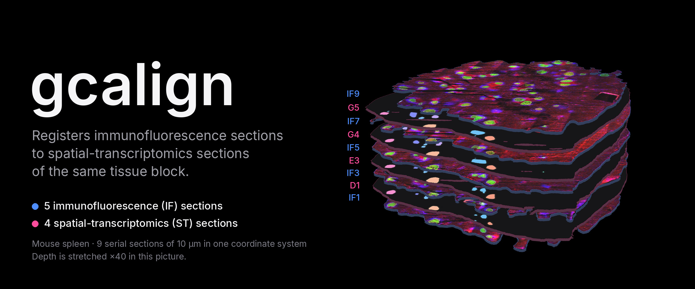
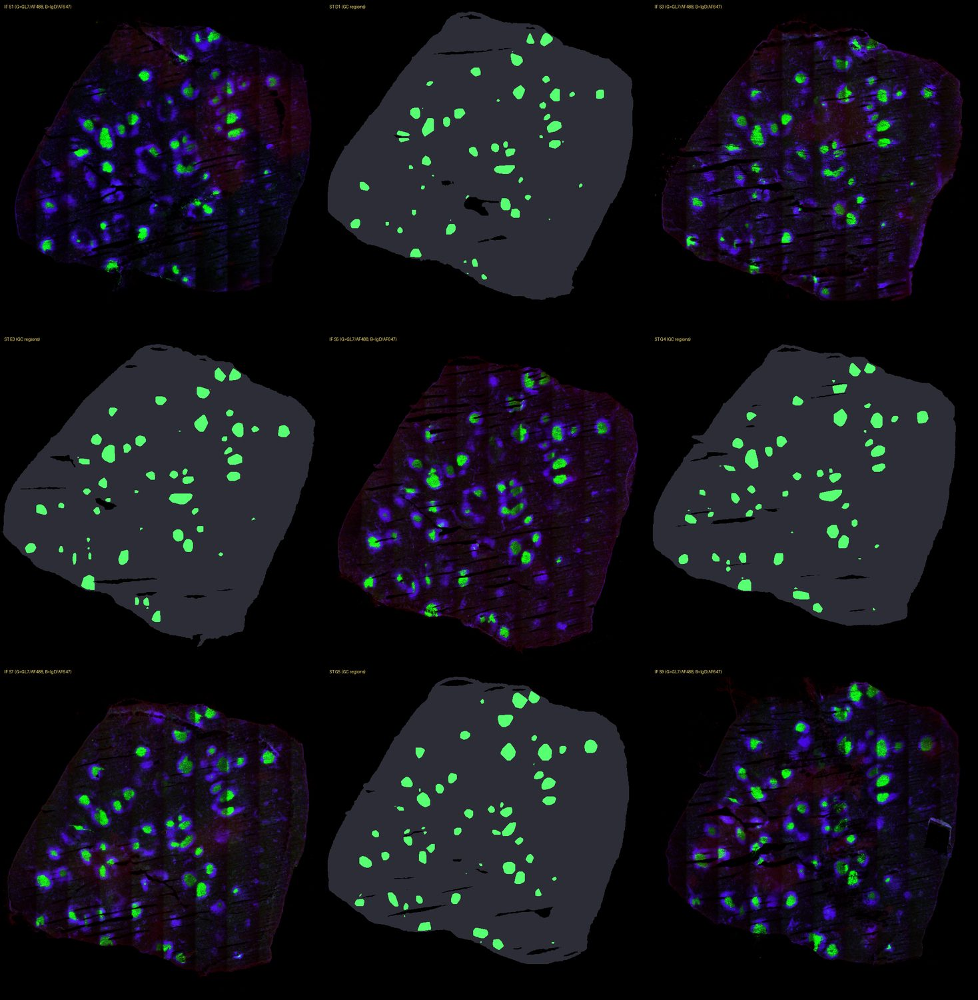
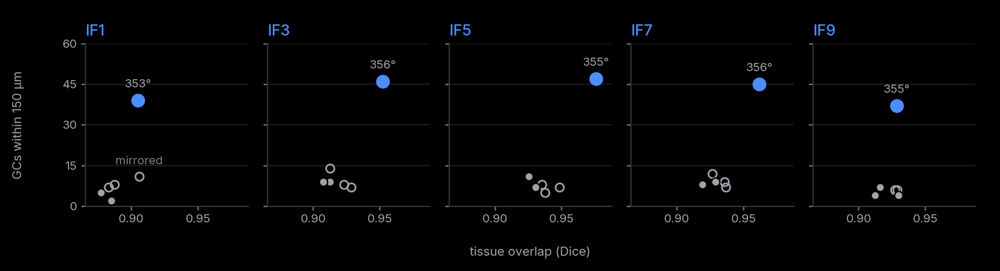
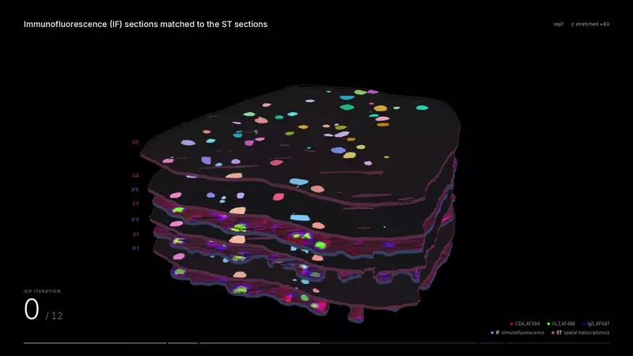
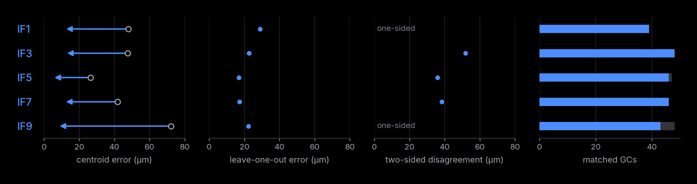
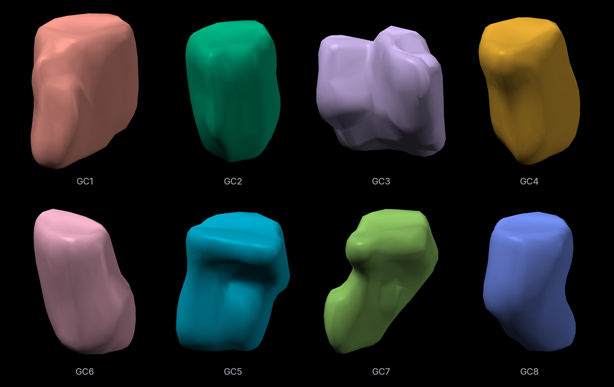
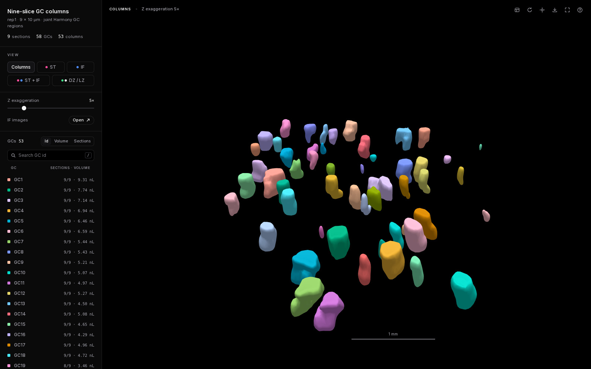

<p align="center"></p>

<h1 align="center">gcalign</h1>

<p align="center">
<b>Registers immunofluorescence sections to spatial-transcriptomics sections of the same tissue block.</b>
</p>

<p align="center">


</p>

## What gcalign does

A tissue block is cut into serial sections. Some sections are imaged by
**immunofluorescence (IF)**; the others are profiled by **spatial transcriptomics (ST)**.
gcalign places every IF section in the coordinate system of the ST sections. After that,
all sections share one coordinate system.

| | |
| --- | --- |
| **Input** | IF images of the IF sections (Zeiss CZI or TIFF), and one AnnData file with the ST sections. The ST sections must already be registered to each other, and each ST bin must carry the id of the structure it belongs to. |
| **Output** | The position of every IF section in the ST coordinate system · one id per structure on all sections · a 3D surface of each structure · an interactive viewer · figures · a quality report · a film · the IF intensity at every ST bin · registered IF images at any pixel size. |
| **Method** | gcalign matches structures that IF and ST detect independently. It does not match pixels or cells. In our data the structures are germinal centres (GCs): IF detects them by GL7 staining, ST detects them as a transcriptional cluster. |
| **Tested on** | Mouse spleen, two replicates. Each replicate has nine consecutive 10 µm sections: five IF sections and four Stereo-seq sections. |

<table>
<tr>
<td width="50%"></td>
<td width="50%"></td>
</tr>
<tr>
<td align="center">Replicate 1: 58 GCs, 30 of them present on all nine sections</td>
<td align="center">Replicate 2: 75 GCs, 38 of them present on all nine sections</td>
</tr>
</table>

The two films replay the registration of our two replicates in 20 seconds each. They are
rendered by `gcalign animate` from the files of the finished runs. Each film shows, in
this order: the ST sections being registered to each other (by Spateo, before gcalign);
the ST sections stacked in cutting order; one IF section being matched to its
neighbouring ST sections; all nine sections in one coordinate system; and one turn of the
stack, with GCs from IF sections in blue and GCs from ST sections in pink.

The full-length films (86 seconds each) show the matching of every IF section. They are
attached to the [0.2.0 release](https://github.com/Reynold4k/gc-serial-align/releases/tag/v0.2.0)
as MP4 files, together with the two 20-second films and a smaller copy of each full-length
film for slides.

## Install

```bash
git clone https://github.com/Reynold4k/gc-serial-align.git
cd gc-serial-align
pip install -e .
```

gcalign needs Python 3.9 or later. It runs on a CPU; no GPU is needed.

## Quick start

**1. Describe the experiment in one YAML file.** List the sections in the order in which
they were cut, and state for each section whether it is IF or ST.
[`configs/template.yaml`](configs/template.yaml) explains every setting.

```yaml
name: my_experiment
output_dir: ./out
section_thickness_um: 10.0

sections:                                  # in cutting order
  - {index: 1, kind: IF, source: 1}        # IF image: Section1_stitched.czi
  - {index: 2, kind: ST, source: CHIP_A, name: A}   # ST section labelled CHIP_A in the AnnData
  - {index: 3, kind: IF, source: 3}
  - {index: 4, kind: ST, source: CHIP_B, name: B}
  - {index: 5, kind: IF, source: 5}

if_images:
  dir: /path/to/if_images
  filename_template: "Section{index}_stitched.czi"
  um_per_px: 0.8286                        # pixel size of the IF images
  channels: {0: IgD_AF647, 1: CD4_AF594, 2: GL7_AF488, 3: DAPI}
  gc_channel: GL7_AF488                    # the channel that shows the structure
  tissue_channels: {CD4_AF594: 1.0, IgD_AF647: 0.6, GL7_AF488: 0.3}

st_scaffold:
  h5ad: /path/to/registered_st_sections.h5ad
  coord_key: align_deformable              # obsm key with the registered coordinates
  slice_col: slice_name                    # obs column with the section label
  gc_id_col: gc_id                         # obs column with the structure id (0 = none)
```

**2. Check the inputs.** This command opens every file and reports problems. It writes
nothing.

```bash
gcalign check --config my_experiment.yaml
```

**3. Run the registration.** Nine sections take about 5 minutes on one CPU and 1 to
1.5 minutes on five.

```bash
gcalign run --config my_experiment.yaml --jobs 0     # --jobs 0 = use all CPUs
```

**4. Look at the result.**

```bash
gcalign report --config my_experiment.yaml           # writes out/06_figures/report.html
```

Open `out/05_viewer/gc_columns.html` (the 3D viewer) and `out/06_figures/report.html`
(the quality report) in a browser.

## What a run produces

| File or folder | Content |
| --- | --- |
| `05_viewer/*.html` | interactive 3D viewer; one file, no network needed |
| `06_figures/report.html` | quality report: numbers and figures on one page (`gcalign report`) |
| `06_figures/*.png` | figures on a black background (`gcalign figures`) |
| `03_gc_match/section_transforms.json` | the registration of each IF section |
| `03_gc_match/plane_gc_labels.npz` | the GC id at each pixel of each section, in the common coordinate system |
| `03_gc_match/if_channels_warped.npz` | the registered IF images at 10 µm per pixel |
| `03_gc_match/gc_presence.csv` | the area of each GC on each section |
| `04_columns/gc_column_metrics.csv` | volume, radius and drift of each GC |
| `validation_report.json` | all quality numbers |

[docs/outputs.md](docs/outputs.md) describes every file.

## Commands

| Command | Purpose |
| --- | --- |
| `gcalign show` | print the section layout derived from the config |
| `gcalign check` | test the input files before a run |
| `gcalign run` | run the registration |
| `gcalign figures` | draw the result as PNG figures |
| `gcalign report` | write the quality report (one HTML page) |
| `gcalign animate` | render a film of the registration |
| `gcalign transfer` | read the IF intensity of each channel at every ST bin |
| `gcalign export` | write an IF section as a registered OME-TIFF image at a chosen pixel size |
| `gcalign map` | convert point coordinates between an IF image and the ST coordinate system |

[docs/commands.md](docs/commands.md) describes each command, its options and its output,
and the Python interface.

## Results on our data

The figures below are from replicate 1. They are drawn by `gcalign figures`.
[docs/figures.md](docs/figures.md) explains every figure in detail.

### All sections in one coordinate system

<p align="center"></p>

The nine sections after registration, in cutting order. IF sections (blue names) show the
stain: CD4 red, GL7 green, IgD blue. ST sections (pink names) show the tissue in dark grey
and each GC in its own colour. A GC has the same colour on every ST section.

### The orientation is chosen by the GCs, not by the tissue outline

<p align="center"></p>

One panel per IF section. Each mark is one tested orientation (mirror state and rotation).
The x axis is the overlap of the tissue outlines; the y axis is the number of GC centres
that lie within 150 µm of the matching GC on the ST section. The large blue dot is the
orientation that was chosen, and the number above it is its rotation angle. A grey dot is
a rejected orientation that is not mirrored; a grey ring is a rejected orientation that is
mirrored. The tested orientations differ little in tissue overlap and strongly in the
number of matching GCs. On two of these five sections a wrong orientation had a slightly
higher tissue overlap than the correct one.

### Matching one IF section to its neighbouring ST sections

<p align="center"></p>

IF section IF5 of replicate 1 is matched to the ST sections before and after it (E3 and
G4). The film shows the 12 iterations of the placement step (iterative closest point,
ICP) that the pipeline stored, in order, and then the result of the elastic warp. The
image is the IF stain. Coloured outlines are the GC regions of the two ST sections. A blue
dot is the centre of a GC on the IF section; a pink ring is the centre of the matching GC
on the ST sections; a line joins each matched pair. The panel on the right gives the
number of matched pairs and their mean distance at each iteration.

### Registration error

<p align="center"></p>

One row per IF section. From left to right: distance between matched GC centres before
(ring) and after (arrow head) the elastic warp; leave-one-out error of the warp;
disagreement between the two neighbouring ST sections; number of GCs used.

| | Replicate 1 | Replicate 2 |
| --- | --- | --- |
| Distance between matched GC centres before the elastic warp (median per IF section) | 27–72 µm | 50–96 µm |
| Distance between matched GC centres after the elastic warp | 6–13 µm | 0.2–24 µm |
| Leave-one-out error of the elastic warp | 17–29 µm | 18–47 µm |
| Disagreement between the two neighbouring ST sections | 36–52 µm | 65–76 µm |
| GCs found in the stack | 58 | 75 |
| GCs present on all nine sections | 30 | 38 |
| 3D surfaces built / closed | 53 / 53 | 70 / 70 |

For comparison, the median diameter of a GC cross-section in these sections is 200–250 µm.

### Agreement of the GC regions between IF and ST

<p align="center"></p>

The GC regions of all nine sections drawn on top of each other. Pink = GC regions from ST
sections. Blue = GC regions from IF sections. White = both. The right panel enlarges the
area marked by brackets in the left panel.

### 3D surface of each GC

<p align="center"></p>

The eight largest GCs of replicate 1. Each surface is built from the outlines of one GC on
the nine sections. Depth is stretched five times.

### The interactive viewer

<p align="center"></p>

The viewer is one HTML file that opens in a web browser without a network connection.
The picture shows the view "Columns": the 3D surface of each of the 53 GCs of replicate 1
that have a surface, each GC in its own colour, and the list of GCs on the left. Other
views show the outline of each GC on the ST sections, on the IF sections, or on both.
Clicking a GC shows its volume, radius and cross-section area on every section. A table
lists the registration quality of each IF section. [docs/viewer.md](docs/viewer.md)
describes every control.

## Limitations

- **The 3D surfaces cover only part of each GC.** Nine 10 µm sections are 90 µm of tissue.
  A GC in mouse spleen has a diameter of 200–400 µm. The surfaces show how a GC continues
  from section to section. They do not show the whole shape of a GC.
- **The registration maximises the overlap of GCs between sections,** because the GCs are
  the landmarks. The 3D surfaces are suitable for showing shape. They are not suitable for
  statistics on GC volume.
- **The first and the last section of a stack have only one ST neighbour.** Their
  registration is less certain, and no two-sided error estimate exists for them.
- **gcalign needs registered ST sections as input.** It does not register ST sections to
  each other. We used [Spateo](https://github.com/aristoteleo/spateo-release) for that step.

## Use with other tissues and structures

gcalign needs a class of structure that is discrete, numerous, irregularly arranged, and
detectable separately in IF and in ST. Follicles, glomeruli, islets, tumour nests, crypts
and granulomas are candidates. Set `gc_channel` to the IF channel that shows the structure
and `gc_id_col` to the column of the AnnData file that holds the structure id.

gcalign does not work for tissue without such structures, or when only one of the two
modalities detects them. We have tested it on mouse spleen only.

## Documentation

| Page | Content |
| --- | --- |
| [docs/method.md](docs/method.md) | the method, step by step, in plain terms |
| [docs/how-it-works.md](docs/how-it-works.md) | implementation details of each pipeline stage |
| [docs/commands.md](docs/commands.md) | every command and the Python interface |
| [docs/outputs.md](docs/outputs.md) | every output file |
| [docs/figures.md](docs/figures.md) | what each figure shows |
| [docs/viewer.md](docs/viewer.md) | the interactive viewer: views, controls, keyboard shortcuts |
| [docs/theme.md](docs/theme.md) | the colours and the font of all output |
| [docs/reproduce-prompt.md](docs/reproduce-prompt.md) | steps for your own data; a prompt to rebuild the pipeline with an AI assistant |
| [films/README.md](films/README.md) | the film: acts, inputs, and what is staged |
| [viewer_layers/README.md](viewer_layers/README.md) | optional layers of the viewer (B follicles, dark and light zone) |
| [figures_2d/README.md](figures_2d/README.md) | figures of the dark and light zone of single GCs |
| [tests/README.md](tests/README.md) | the tests and the synthetic test data |
| [CHANGELOG.md](CHANGELOG.md) | changes between versions |

## Citation

If you use gcalign in published work, cite this repository and the tools it builds on:
Spateo (registration of the ST sections), scikit-image, SciPy, PyVista and Plotly.

## Licence

The code is released under the MIT licence ([LICENSE](LICENSE)). The Inter font files in
`gcalign/assets/fonts` are released under the SIL Open Font License 1.1.
