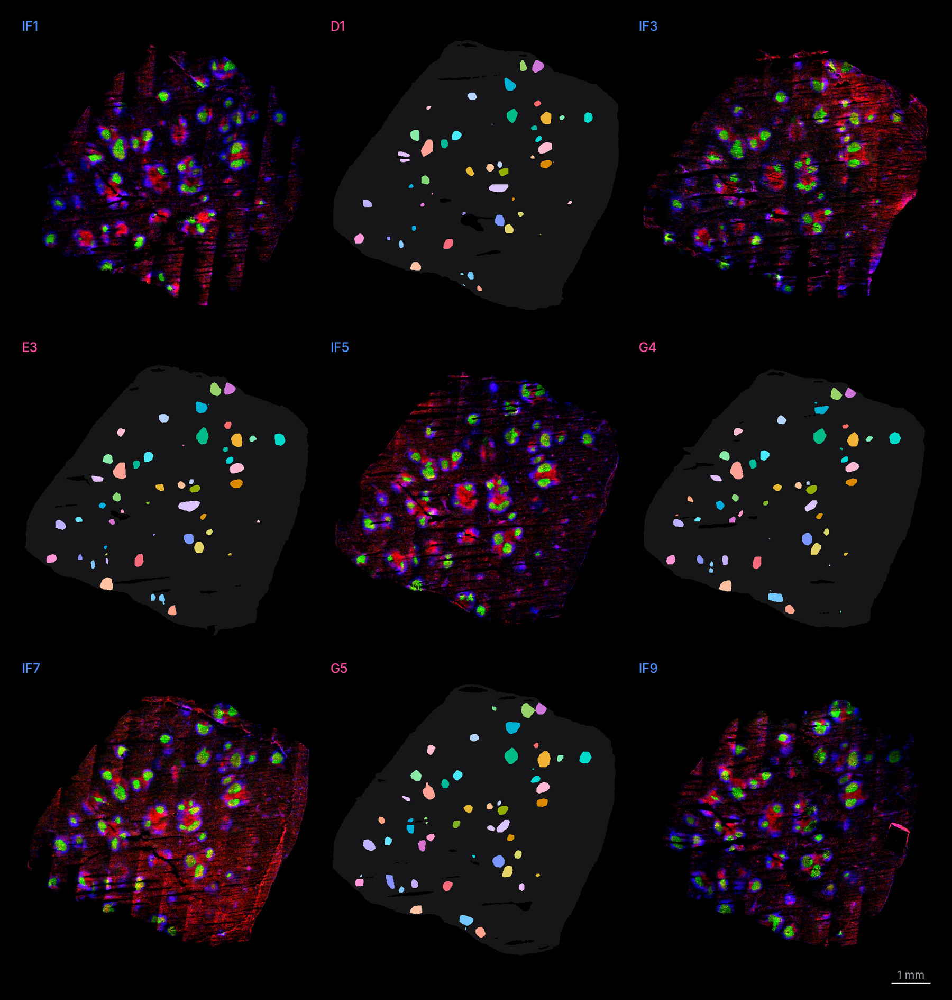
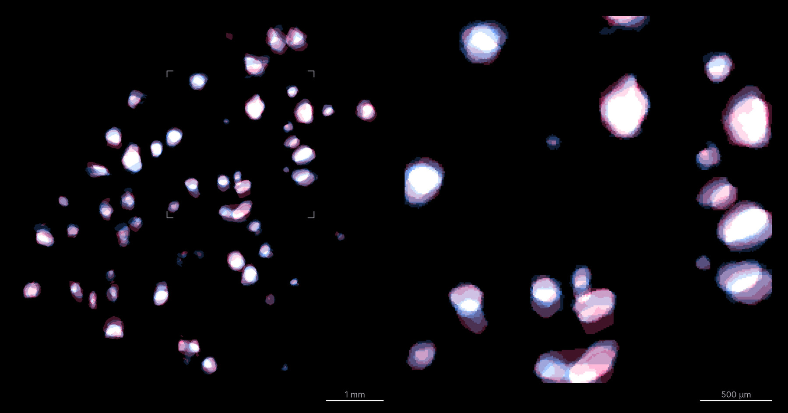
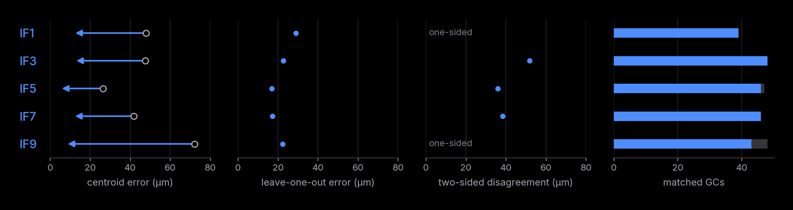
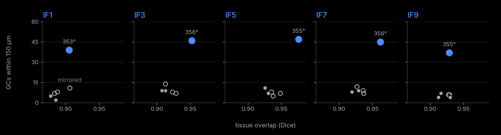
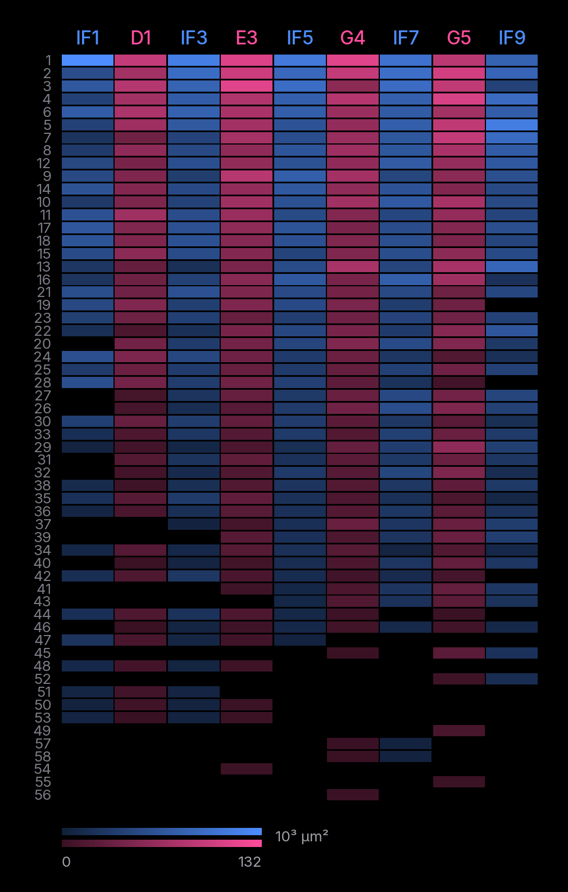
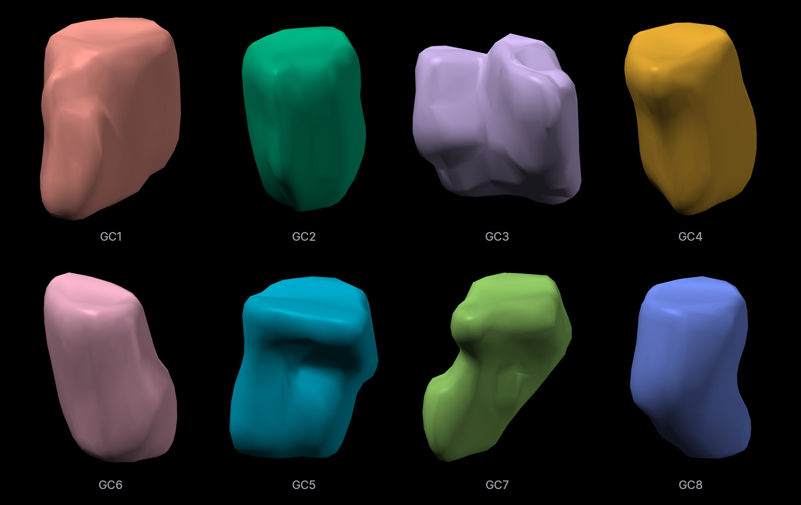
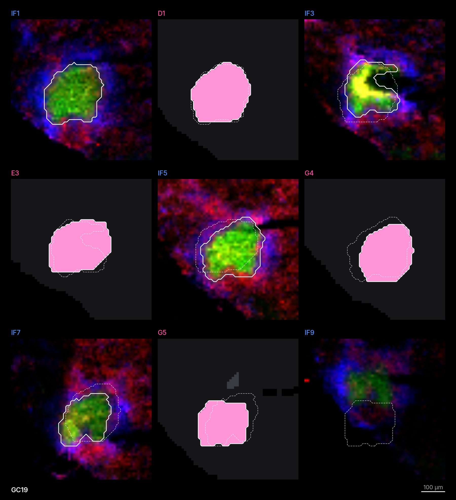
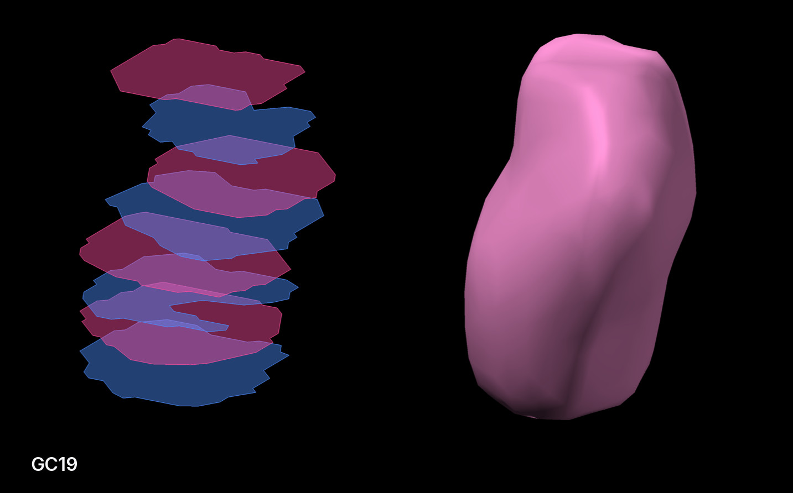
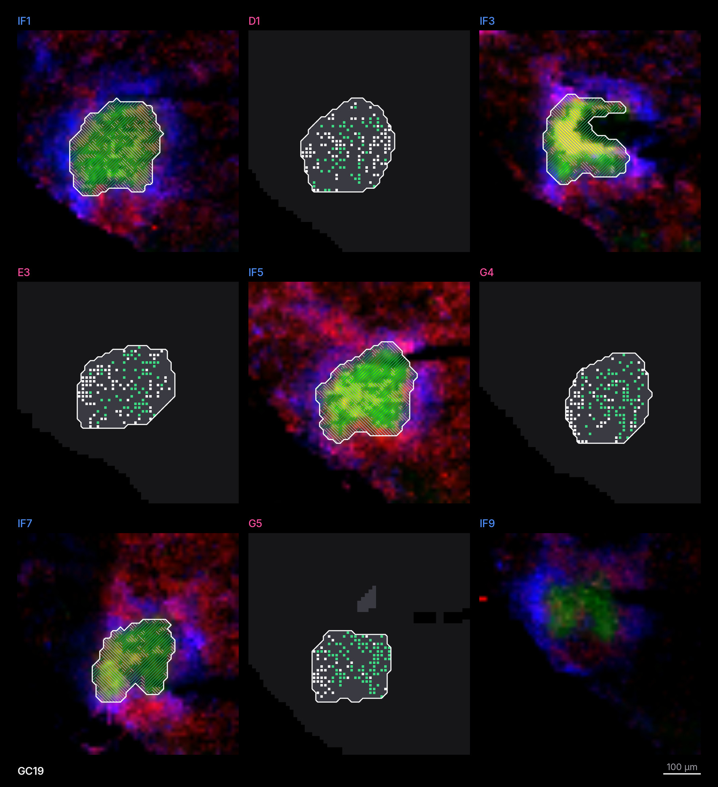

# Figures

`gcalign figures` draws the result of a finished run as PNG files in `06_figures/`. The
figures have a black background and contain no titles or captions. This page explains what
every figure shows. The examples are from replicate 1 of our data (mouse spleen, nine
10 µm sections: five IF, four ST).

Terms: **IF** = immunofluorescence; **ST** = spatial transcriptomics; **GC** = germinal
centre; **common grid** = the pixel grid of the registered frame (10 µm per pixel);
**identity colour** = the colour assigned to one GC id, the same in every gcalign output.

| Figure | File | Drawn by |
| --- | --- | --- |
| [sections](#sections) | `sections.png` | `gcalign figures` |
| [overlay](#overlay) | `overlay.png` | `gcalign figures` |
| [alignment](#alignment) | `alignment.png` | `gcalign figures` |
| [orientation](#orientation) | `orientation.png` | `gcalign figures` (runs made with gcalign 0.2 or later) |
| [presence](#presence) | `presence.png` | `gcalign figures` |
| [columns](#columns) | `columns.png` | `gcalign figures` |
| [close-up of one GC](#close-up-of-one-gc) | `gc_closeups/GC<id>.png` | `gcalign figures --gc <id>` |
| [column of one GC](#column-of-one-gc) | `columns/GC<id>.png` | `gcalign figures --gc <id>` |
| [dark zone and light zone of one GC](#dark-zone-and-light-zone-of-one-gc) | chosen by `--out` | `figures_2d/plot_dzlz_split.py` |

To draw only some figures: `gcalign figures --config my.yaml --only sections,overlay`.

## sections

- All sections of the stack in cutting order (left to right, top to bottom), after
  registration, on the common grid and at one scale.
- The section name above each panel is blue for an IF section and pink for an ST section.
- **IF sections** show the stain: the three display channels as red, green and blue (in
  our data CD4 red, GL7 green, IgD blue). The image is cut to the tissue outline. All IF
  sections use the same display limits, so their brightness can be compared.
- **ST sections** show the tissue outline in dark grey. Each GC region is filled with the
  identity colour of that GC.
- The bar at the bottom right is the scale bar; its length is written above it.

## overlay

- **Left panel:** the GC regions of all sections drawn on top of each other. A pixel is
  pink if only ST sections have a GC there, blue if only IF sections have a GC there, and
  white if every IF section and every ST section has a GC there. Pink and blue are brighter
  when a larger fraction of the sections of that kind have a GC at the pixel.
- **Right panel:** an enlargement of the square marked by corner brackets in the left
  panel. The square is the one (40% of the panel width) that contains the largest GC area.
- Each panel has its own scale bar.

How to read it: a GC with a white centre and thin coloured edges is in the same place on
all sections. Coloured edges show how the cross-section of the GC changes from section to
section.

## alignment

One row per IF section, in cutting order. Four panels:

1. **centroid error (µm):** the median distance between the centres of matched GCs on the
   IF section and on the ST section. Grey ring = before the elastic warp. Blue arrow head =
   after the elastic warp.
2. **leave-one-out error (µm):** the error of the elastic warp at a GC that was left out
   when the warp was fitted (median over all GCs, each left out in turn). It estimates the
   registration error at a position that was not used to fit the warp.
3. **two-sided disagreement (µm):** the median distance between the warp fitted to the ST
   section before and the warp fitted to the ST section after the IF section. The first
   and last IF section have one ST neighbour and are marked "one-sided".
4. **matched GCs:** blue = number of GCs on the IF section that were used as anchors of the
   warp. Grey = number of all GC regions found on the IF section.

Lower is better in panels 1 to 3. They share one scale.

## orientation

One panel per IF section. Each mark is one orientation candidate (mirror state and
rotation) that was tested in full.

- **x axis:** overlap of the tissue outlines of the IF section and the ST section (Dice
  coefficient, 0 to 1).
- **y axis:** number of GC centres of the IF section that lie within 150 µm of the matched
  GC centre of the ST section.
- **Large blue dot:** the candidate that was chosen. The number is its rotation angle.
- **Grey dots:** rejected candidates that are not mirrored. **Grey rings:** rejected
  candidates that are mirrored.

How to read it: the candidates differ little along the x axis and strongly along the y
axis. The tissue outline cannot identify the correct orientation; the GCs can.

## presence

- One row per GC, labelled with the GC id. Rows are ordered by total cross-section area,
  largest first.
- One column per section in cutting order. Column headings are blue for IF and pink for ST.
- The brightness of a cell is the cross-section area of the GC on that section. The scale
  below the matrix gives the range in 10³ µm².
- A black cell means that the GC is absent from that section. A row without black cells is
  a GC that is present on every section.

## columns

- The eight GCs with the largest measured volume. Each tile shows the 3D surface (column)
  of one GC, in its identity colour, with the GC id below.
- All tiles use the same camera (20° above the section plane) and the same scale.
- Depth (z) is stretched by the factor `viewer.default_z_exaggeration` (5 by default),
  because the stack is thin compared with the width of a GC.

## close-up of one GC

- One GC on every section, in cutting order. All panels show the same square region of the
  common grid, so a shift of the GC between panels is a real shift in the registered data.
- **IF sections** show the stain. The display limits are computed from this region.
- **ST sections** show the tissue in dark grey, this GC in its identity colour and other
  GCs in lighter grey.
- **White outline:** this GC on this section. **Dashed outline:** this GC on the previous
  section. A panel without a white outline is a section on which the GC is absent.
- The GC id is at the bottom left; the scale bar is at the bottom right.
- The numbers for each section (area, radius, centre) are written to
  `gc_closeups/gc_closeups.csv`.

## column of one GC

- **Left:** the measured cross-sections of the GC at their depths, drawn as flat shapes.
  Blue = IF sections, pink = ST sections.
- **Right:** the 3D surface built from these cross-sections, in the identity colour of the
  GC. Camera, scale and depth stretch are the same as in the `columns` figure.

## dark zone and light zone of one GC

This figure is drawn by `figures_2d/plot_dzlz_split.py`
([instructions](../figures_2d/README.md)). It needs cell-type weights for the ST sections
(RCTD), which are not part of a gcalign run.

- The layout is the close-up of one GC.
- **IF sections:** the GC is divided at the median intensity of one channel (CD4 in our
  data). Pixels at or above the median are the light zone and are hatched in white. Pixels
  below the median are the dark zone and are hatched in green. The stain stays visible
  between the hatch lines.
- **ST sections:** each bin inside the GC is a small square: green for a dark-zone bin,
  white for a light-zone bin. A bin belongs to a zone if the RCTD weight of that zone is at
  least 0.15.
