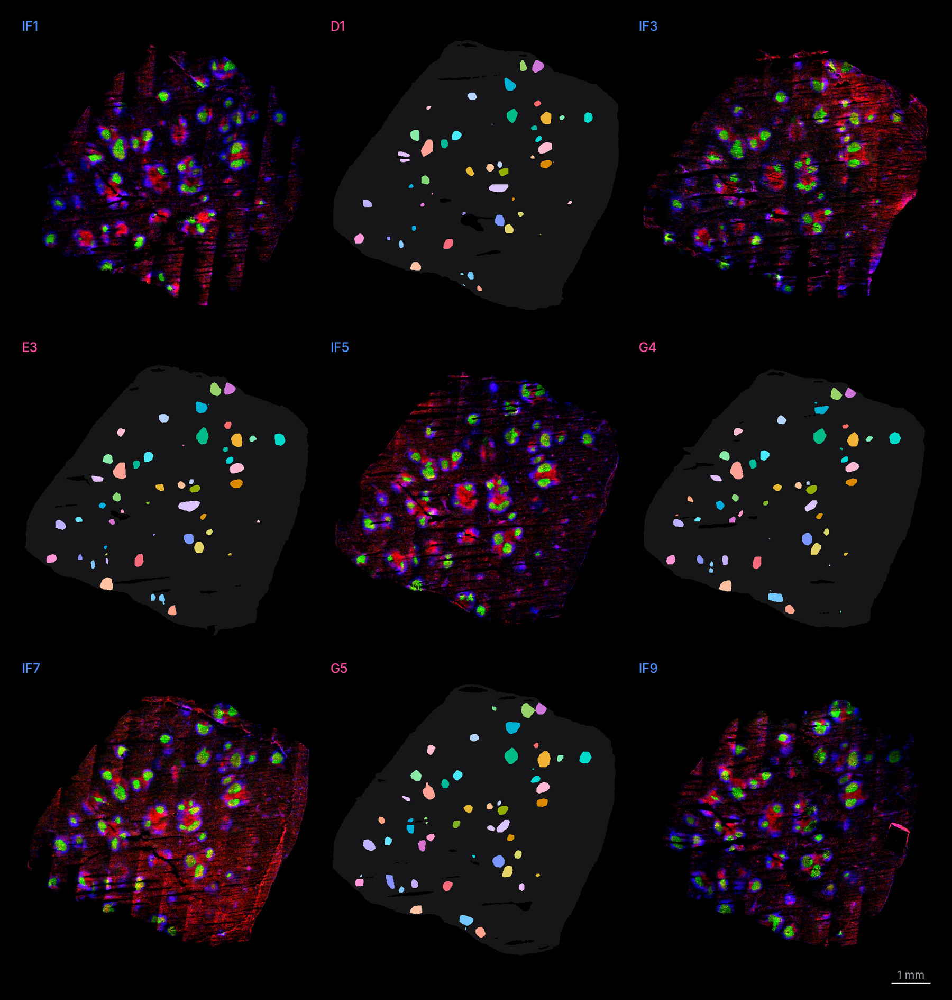
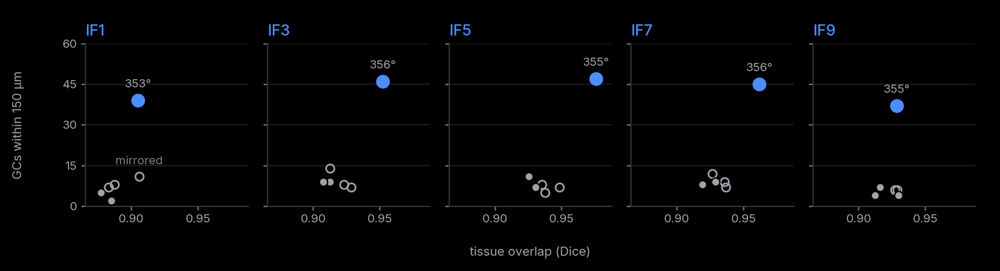
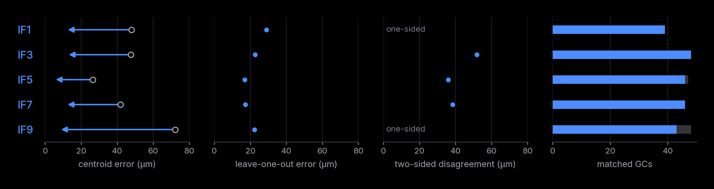
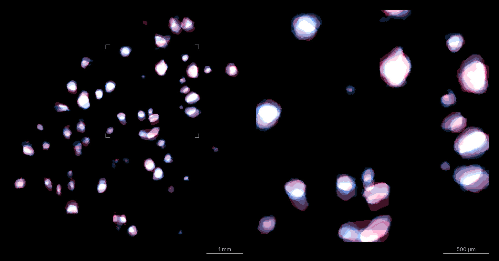
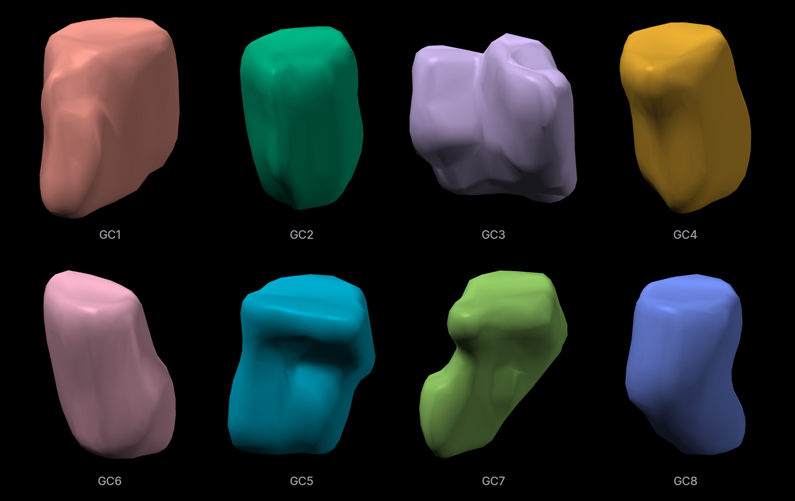

# Method: how gcalign registers IF sections to ST sections

This page explains the method in plain terms. Implementation details (segmentation,
parameters, known pitfalls) are in [how-it-works.md](how-it-works.md).

## Terms used on this page

| Term | Meaning |
| --- | --- |
| IF section | a tissue section imaged by immunofluorescence (protein stains) |
| ST section | a tissue section profiled by spatial transcriptomics (Stereo-seq in our data) |
| GC | germinal centre — the structure used as the landmark for registration |
| frame | the coordinate system of the registered ST sections, in micrometres |
| placement | the mirror state, rotation, scale and shift that put an IF section into the frame |
| warp | a smooth elastic correction applied after the placement (a thin-plate spline) |
| anchor | a GC found on an IF section and matched to the same GC on an ST section |

## What the input is and what the output is

**Input.** One tissue block cut into serial sections. Some sections were used for IF, the
others for ST, usually alternating. The ST sections are already registered to each other
(we used [Spateo](https://github.com/aristoteleo/spateo-release); any method works), and
each ST bin carries the id of the GC it belongs to.

**Output.** Every IF section placed in the frame of the ST sections, so that all sections
share one coordinate system. Each GC then has one id on every section it appears on, and
its outlines can be stacked into a 3D shape.

## Why the registration is difficult

1. **Each section lies differently on its slide.** A section is picked up by hand. It is
   rotated by an unknown angle, may be flipped (mirrored), and is slightly stretched.
2. **IF and ST measure different quantities.** IF measures protein fluorescence; ST counts
   mRNA per bin. Pixel intensities of the two cannot be correlated directly.
3. **Neighbouring sections contain different cells.** Two 10 µm sections share no cells, so
   cell-to-cell matching between sections is impossible.

## Approach: match structures that both modalities detect independently

gcalign does not match pixels or cells. It matches structures that IF and ST each detect
on their own. In spleen it uses GCs:

- IF detects a GC by GL7 staining; ST detects it as a transcriptional cluster.
- A section holds 40–60 GCs, each a compact region with a clear boundary.
- The GCs are scattered irregularly. Their arrangement is unique enough to fix rotation,
  mirror state and position, in the same way a star pattern fixes the orientation of a
  star chart.

The figure shows every section of one stack in cutting order, after registration. Section
names are blue for IF and pink for ST. IF sections show the stain (CD4 red, GL7 green, IgD
blue). ST sections show the tissue outline in dark grey and each GC region in its own
colour; a GC has the same colour on every ST section and in all other gcalign output.

gcalign never assigns a transcriptome to IF cells and never claims that a cell on one
section is the same cell on another. It compares two independent measurements of the GC
pattern.

## Step 0: the ST coordinates are never changed

gcalign reads the registered ST coordinates and does not modify them. GC ids curated on
the ST sections therefore stay valid. Each IF section is fitted into that fixed frame.

## Step 1: find the mirror state and rotation of each IF section

For each IF section gcalign tests every orientation: both mirror states × every rotation
in 5° steps. For each orientation it finds the best shift by Fourier cross-correlation of
the tissue outlines. It keeps the six best candidates, refines each, and then chooses the
candidate under which the most GC centres lie within 150 µm of a GC centre on the
neighbouring ST section.

The choice uses GC agreement and not tissue overlap, because tissue overlap cannot tell a
section from its mirror image when the tissue outline is nearly convex. Example from our
data (one IF section, replicate 1):

| Candidate | Tissue overlap (Dice) | GC centres within 150 µm |
| --- | --- | --- |
| correct: not mirrored, 355° | 0.9285 | 37 |
| wrong: mirrored, 316° | 0.9291 | 6 |
| wrong: not mirrored, 258° | 0.9301 | 4 |

Tissue overlap ranked two wrong candidates above the correct one. GC agreement separates
them clearly. The figure plots both scores for every candidate of every IF section; the
chosen candidate is highlighted.

## Step 2: correct the stretch with an elastic warp

After the placement, the remaining error is physical distortion of the tissue. gcalign
matches each GC on the IF section to the same GC on the ST section (these pairs are the
anchors) and fits a thin-plate spline through them. A thin-plate spline is a smooth
deformation with one parameter, its stiffness.

The stiffness is chosen by leave-one-out cross-validation: one anchor is removed, the
spline is fitted on the others, and the distance between the predicted and the true
position of the removed anchor is recorded. The stiffness with the smallest median
distance is used. This prevents the spline from bending to fit noise.

Results in replicate 1: the median distance between matched GC centres fell from 27–72 µm
(after placement) to 6–13 µm (after the warp). The leave-one-out error was 17–29 µm. A GC
has a radius of about 110 µm.

## Step 3: use both neighbouring ST sections and report how much they disagree

An IF section inside the stack lies between two ST sections. gcalign matches its GCs to
each of the two ST sections separately. The final warp uses, for each GC, the average of
its two target positions. gcalign also fits one warp per ST neighbour and reports the
median distance between these two warps as the **two-sided disagreement**. It is an error
estimate for that IF section that needs no extra experiment. In our two replicates it was
36–52 µm and 65–76 µm.

The first and the last section of a stack have only one ST neighbour. Their placement is
less certain, and the report marks them as one-sided.

## Result

The overlay shows all sections of one stack in the frame. Pink marks GC regions from ST
sections, blue marks GC regions from IF sections, and white marks where both overlap.

Each GC has one id across all sections. Its outlines are stacked into a 3D surface, called
a column:

The surface is smoothed by blurring the stacked outlines as a volume and drawing the
surface through the blurred volume. The surface level is chosen so that the enclosed
volume equals the volume measured from the sections. In our two replicates (53 and 70
columns) every surface is closed, and the median surface encloses 99% of the measured
volume.

## Limitations

**The stack depth limits what the 3D shapes show.** Nine 10 µm sections are 90 µm of tissue. A GC
in mouse spleen is 200–400 µm across. The columns are therefore a slab through the middle
of each GC, not a whole GC, and they do not show whether a GC is spherical. To capture
whole GCs, keep sections further apart (about 25 µm spacing for our tissue). `gcalign
check` compares the stack depth with the GC size before a run.

**The registration is driven by the GCs, so GC overlap between sections is maximised.**
This is appropriate for displaying 3D shape. It is not appropriate for statistics on GC
volume, because the measured overlap partly reflects the registration itself.

## Use with other tissues and structures

The method needs a class of structure that is (1) discrete, (2) numerous, (3) irregularly
arranged, and (4) detectable separately in IF and in ST. Follicles, glomeruli, islets,
tumour nests, crypts and granulomas are candidates. Set `gc_channel` to the IF marker of
the structure and `gc_id_col` to the ST label of the structure.

The method does not work for tissue without such structures, or when only one modality
detects them.
