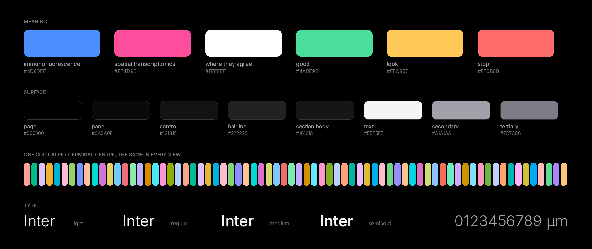

# Colours and fonts

All output of gcalign — the HTML viewer, the figures, the report and the film — uses the
same colours and the same font. They are defined in one file,
[`gcalign/theme.py`](../gcalign/theme.py). The image below is generated from that file.

<p align="center"></p>

## Rules

| Element | Rule |
| --- | --- |
| Background | pure black, `#000000`, in every output |
| Text and lines | neutral greys: `#F5F5F7` (text), `#A1A1AA` (secondary text), `#7C7C86` (tertiary text), `#222225` (thin lines) |
| Immunofluorescence (IF) | blue, `#4D8DFF` |
| Spatial transcriptomics (ST) | pink, `#FF4D9D` |
| Overlap of IF and ST | white, `#FFFFFF` |
| Germinal centres (GCs) | one colour per GC id; a GC has the same colour in every output |
| IF stain | each channel in the usual colour of its fluorophore: 594 nm red, 488 nm green, 647 nm blue. Change the assignment with `if_images.display_rgb` in the config |
| Font | Inter. The font files are part of the package, so the output looks the same on every computer |
| Text in figures | no titles and no captions; only section names, scale bars and units |

## The GC colours

The default palette is called `aurora`. Its colours have a similar brightness, and
consecutive GC ids get clearly different hues.

gcalign 0.1 and the four-section atlas used a different palette. To use that palette
again, set this in the config:

```yaml
viewer:
  palette: hsv
```

All outputs follow this setting.

## Using the theme in your own plots

```python
from gcalign import theme

theme.use_mpl()                                   # set matplotlib to the gcalign colours and font
ax.plot(x, y, color=theme.IF)                     # the IF blue
ax.set_title("IF3", fontproperties=theme.mpl_font("medium"))

colours = theme.identity_colours(gc_ids)          # dictionary: GC id -> "#RRGGBB"
```

## Licence of the font

Inter is distributed under the SIL Open Font License 1.1. The licence text is in
`gcalign/assets/fonts/OFL.txt`.

## Regenerating the image

```bash
python docs/tools/make_theme_card.py
```
