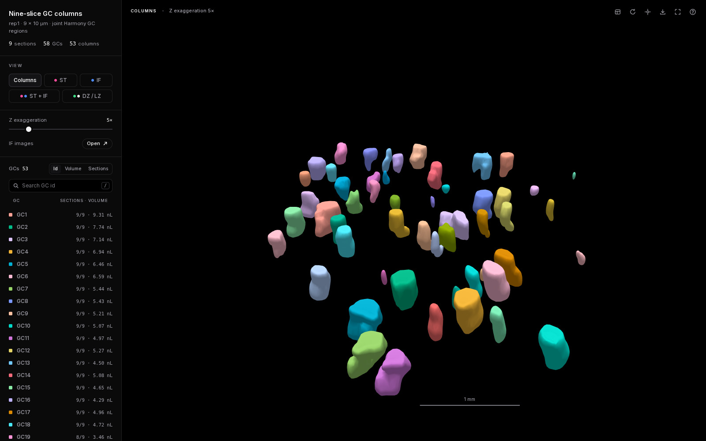
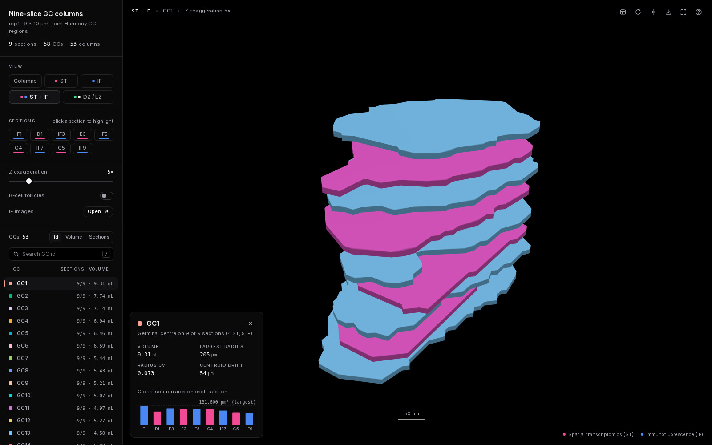
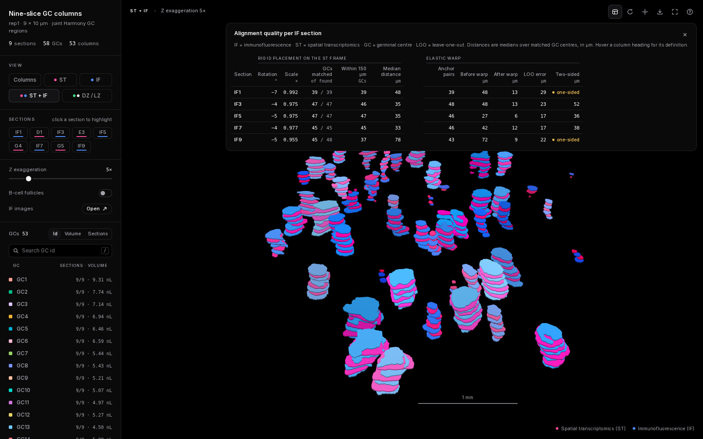

# The interactive viewer

Stage `viewer` of `gcalign run` writes one HTML file, `05_viewer/<name>.html` (the name is
set by `viewer.filename` in the config). Open the file in a web browser. It contains all
its data and needs no network connection and no server.

The viewer shows the result of a run in 3D: the 3D surface of each germinal centre (GC),
the outline of each GC on every section, and the quality numbers of the registration.

Terms: **IF** = immunofluorescence; **ST** = spatial transcriptomics; **GC** = germinal
centre; **section** = one tissue section of the stack (IF or ST); **column** = the 3D
surface of one GC, built from its outlines on all sections.

## Layout

| Area | Content |
| --- | --- |
| Left panel, top | the title of the run and three counts: sections, GCs found, GCs that have a 3D surface |
| Left panel, "View" | buttons that switch between the views (see below) |
| Left panel, "Sections" | one button per section; click a section to highlight it and dim the others |
| Left panel, sliders and switches | the depth stretch, and the optional layers of the run |
| Left panel, list | every GC that has a 3D surface, with the number of sections it is on and its volume; click a GC to select it |
| Centre | the 3D scene. Drag to rotate, scroll to zoom, click a GC to select it |
| Top right | buttons: quality table, automatic rotation, reset camera, save PNG, hide interface, help |
| Bottom | a scale bar and a key of the colours in the current view |

A GC has a 3D surface only if it appears on at least `columns.min_planes` sections (2 by
default). The viewer draws and lists these GCs. In the picture above, 58 GCs were found
and 53 of them have a 3D surface.

## Views

| Key | View | What is drawn |
| --- | --- | --- |
| `1` | Columns | the 3D surface of every GC, each GC in its own colour |
| `2` | ST | the outline of each GC on the ST sections, in shades of pink |
| `3` | IF | the outline of each GC on the IF sections, in shades of blue |
| `4` | ST + IF | the outlines on all sections, pink for ST and blue for IF |
| `5` | DZ / LZ | the dark zone (green) and light zone (white) of each GC. This view exists only when the dark-zone and light-zone layer was built |

## The depth stretch

The stack of sections is thin compared with its width (90 µm deep and several millimetres
wide in our data). The slider "Z exaggeration" stretches the depth axis so that the
sections can be told apart. `1×` is the true proportion. The default is set by
`viewer.default_z_exaggeration` in the config.

## Selecting a GC

Click a GC in the scene or in the list, or type its id in the search field. The scene then
shows only that GC, and a card shows:

| Field | Meaning |
| --- | --- |
| sections | the number of sections on which the GC appears, split into ST and IF |
| volume | the volume measured from the sections: area × section spacing, in nanolitres |
| largest radius | the radius of a circle with the area of the largest outline, in µm |
| radius CV | the coefficient of variation of that radius over the sections |
| centroid drift | the largest distance of an outline centre from the mean centre, in µm |
| cross-section area on each section | one bar per section in cutting order, blue for IF and pink for ST; a dashed slot is a section on which the GC is absent |

Press `Esc` to clear the selection.

The picture shows GC1 of replicate 1 selected in the view "ST + IF": its outline on the
four ST sections (pink) and the five IF sections (blue), and its card at the bottom left.

## The quality table

Press `Q` or the first button at the top right. The table "Alignment quality per IF
section" has one row per IF section.

| Column | Meaning |
| --- | --- |
| Rotation, Scale | the rotation angle and the scale of the placement |
| GCs matched of found | the number of GCs on the IF section that were matched to a GC of the ST sections, and the number of GCs found on the IF section |
| Within 150 µm | the number of matched GCs whose centre lies within 150 µm of the centre of the matching GC |
| Median distance | the median distance between matched GC centres after the placement, in µm |
| Anchor pairs | the number of matched GCs used to fit the elastic warp |
| Before warp, After warp | the median distance between matched GC centres before and after the elastic warp, in µm |
| LOO error | the leave-one-out error of the elastic warp, in µm |
| Two-sided | the median distance between the warps fitted to the ST section before and to the ST section after the IF section, in µm. "one-sided" marks an IF section with only one neighbouring ST section |

## Optional layers

A layer appears in the viewer only if its file exists in the run directory. The scripts
that build these files are in [`viewer_layers/`](../viewer_layers/README.md).

| Control | Layer | File |
| --- | --- | --- |
| "B-cell follicles" switch (`F`) | the B-cell zones around the GCs, as faint points on the sections of the current view. The switch exists in the views "ST", "IF" and "ST + IF" | `05_viewer/follicle_points.npz` |
| view "DZ / LZ" (`5`), "Solids" | one dark-zone and one light-zone solid per GC | `04_columns/zone_blocks.npz` |
| view "DZ / LZ" (`5`), "Points" | the measured dark-zone and light-zone points on each section | `05_viewer/dzlz_points.npz` |
| "IF images" button (`P`) | the registered image of each IF section with GC outlines and ids; scroll to zoom, drag to move | `05_viewer/if_images.json` |

## Keyboard shortcuts

| Key | Action |
| --- | --- |
| `1` to `5` | switch the view |
| `←` `→` | highlight the previous or next section |
| `↑` `↓` | select the previous or next GC in the list |
| `Esc` | close the open panel; press again to clear the selection |
| `Q` | show the quality table |
| `R` | rotate the scene automatically; any drag stops the rotation |
| `0` | reset the camera |
| `S` | save the 3D scene as a PNG image at twice the screen resolution, without the interface |
| `H` | hide the interface, for a clean screenshot |
| `P` | open the IF image of a section |
| `F` | show the B-cell follicles |
| `/` | search for a GC id |
| `?` | show the list of shortcuts |

## Sharing a view

The address of the page records the current view, the selected GC, the highlighted
section, the depth stretch and the camera position. Copy the address to return to the
same view later, or to send it to someone who has the same file.

## If rotation is slow

Rotation is slow when the browser draws 3D graphics without the graphics card. This
happens, for example, when the browser runs on a cluster and is displayed over X11
forwarding. Download the HTML file and open it on your own computer. In Chrome, the page
`chrome://gpu` shows whether hardware acceleration is active.
