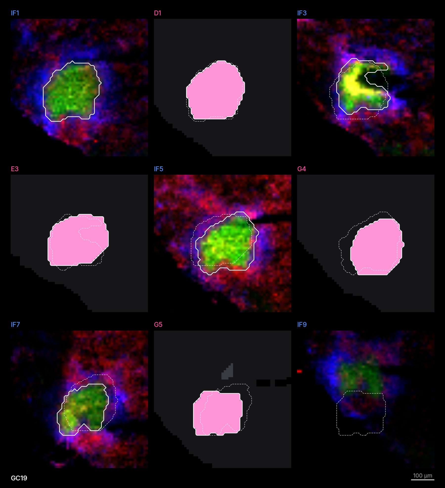

# Flat figures of single germinal centres

The scripts in this folder draw one germinal centre (GC) at a time, flat, on every section of a
finished gcalign run. A 3D surface looks convincing whether or not the segmentation under it is
right; the flat figures show the masks and the stain that the surface was built from, so the
segmentation can be checked by eye.

Abbreviations used below: IF = immunofluorescence, ST = spatial transcriptomics (Stereo-seq in
the example data), GC = germinal centre, DZ = dark zone, LZ = light zone, RCTD = the cell-type
deconvolution method that produced the ST zone weights.

Every script reads the run through `gcalign` and takes the experiment YAML with `--config`.
Section names, channel names and the number of sections come from that file; nothing in the
scripts is specific to one experiment.

| Script | What it draws |
|---|---|
| `plot_gc_closeup.py` | One GC on every section in one shared square window, plus `gc_closeups.csv` with the per-section numbers. The code lives in `gcalign.figures`; this script is a command-line wrapper, and `gcalign figures --gc` draws the same figures. |
| `plot_dzlz_split.py` | The same close-up with the GC split into its dark zone and light zone on every section. |
| `plot_dzlz_all.py` | `plot_dzlz_split.py` for every GC of a run, plus `manifest.csv`. |

## The close-up of one germinal centre

<p align="center"></p>

```bash
python figures_2d/plot_gc_closeup.py --config rep1.yaml --gc 19 --output-dir figures/rep1
```

The figure shows one GC on every section of the run, in cutting order, left to right and top to
bottom. All panels share one square window on the common grid, so a shift of the GC between
panels is a real shift in the aligned data.

- **IF sections** show the stain itself. The display limits are computed from this window and
  shared by all IF sections of the figure.
- **ST sections** show the section in dark grey, this GC in its identity colour (the colour it
  has in every gcalign view) and the other GCs in a lighter grey.
- **White outline**: this GC on this section. **Dashed outline**: this GC on the previous section,
  so growth, shrinkage and drift between neighbouring sections read directly.
- **Labels**: the section name above each panel (blue for IF, pink for ST), the GC id at the
  bottom left, a scale bar at the bottom right.

The figure carries no numbers. `gc_closeups.csv`, written next to the figures, has one row per
GC and section: whether the GC is present, its area in pixels and square micrometres, its
equivalent radius (the radius of a circle with the same area), its centroid, and what fills the
GC's footprint on that section (no GC, or another GC and how much of the footprint it covers).
The footprint is the union of the GC's masks over all sections. A GC that is absent from a
section because its neighbour occupies the footprint is a different problem from a GC that is
absent because there is nothing there; the CSV tells the two apart.

## The dark-zone / light-zone split

<p align="center"></p>

```bash
python figures_2d/plot_dzlz_split.py --config rep1.yaml --gc 19 \
    --weights /path/to/rctd/weights --table-pattern '*{source}_rctd8.csv.gz' \
    --zone-channel CD4_AF594 --output-dir figures/rep1/dzlz
```

The layout is the close-up above, with the two zones of the GC marked on every section.

- **IF sections.** The GC is split at the median of one IF channel inside the GC on that section
  (`--zone-channel`; CD4 in the example, because T follicular helper cells sit in the light
  zone). Pixels at or above the median are the light zone; pixels below are the dark zone. The
  split is per pixel, with no smoothing and no tuned cut point. It is drawn as hatching over the
  untouched stain: dark zone hatched down-right in the DZ colour (green), light zone hatched
  up-right in the LZ colour (white), each line with a thin dark edge so it stays visible on a
  green or red stain. The stain stays visible between the lines, which is what lets a reader
  judge whether the split follows the channel it was computed from. A GC smaller than
  `--min-gc-px` grid pixels (default 60) on a section is not split.
- **ST sections.** Each ST bin inside the GC is a small square: green for a dark-zone bin, white
  for a light-zone bin, nothing for a bin that is neither. A bin belongs to a zone when that
  zone's RCTD weight is at least `--min-weight` (default 0.15); when both weights pass, the
  larger one decides.

### Where the zone weights come from

`--weights` is a folder with one RCTD weight table per ST section. The table of a section is the
one file whose name matches `--table-pattern` after `{source}` is replaced by the section's
`source` in the config (the chip id, for example `B06289D1`). The script stops with a message
if no file or more than one file matches; make the pattern more specific in that case (the
example folder holds several tables per chip, so the example pattern names the `rctd8` table).
A table needs the columns `x` and `y` (chip coordinates in DNB units, the same units as the
run's scaffold) and one column per zone (`--zones`, default `DZ,LZ`). Without `--weights`, the
ST sections are drawn without zones.

## Every germinal centre of a run

```bash
python figures_2d/plot_dzlz_all.py --config rep1.yaml --output-dir figures/rep1/dzlz \
    --weights /path/to/rctd/weights --table-pattern '*{source}_rctd8.csv.gz' \
    --zone-channel CD4_AF594
```

`plot_dzlz_all.py` takes the same arguments as `plot_dzlz_split.py` and draws every GC of the
run (or the ids given with `--gc`). It also writes `manifest.csv`, one row per GC: the figure
file, the number of sections the GC is present on, the number of IF sections on which the GC was
large enough to be split, and the GC's area in grid pixels on every section. Sort the manifest
by the first two counts before looking through the figures: a GC present on two sections gives a
mostly empty figure. A whole run of 60-80 GCs takes a few minutes of CPU; on a cluster, submit
it as a batch job.
