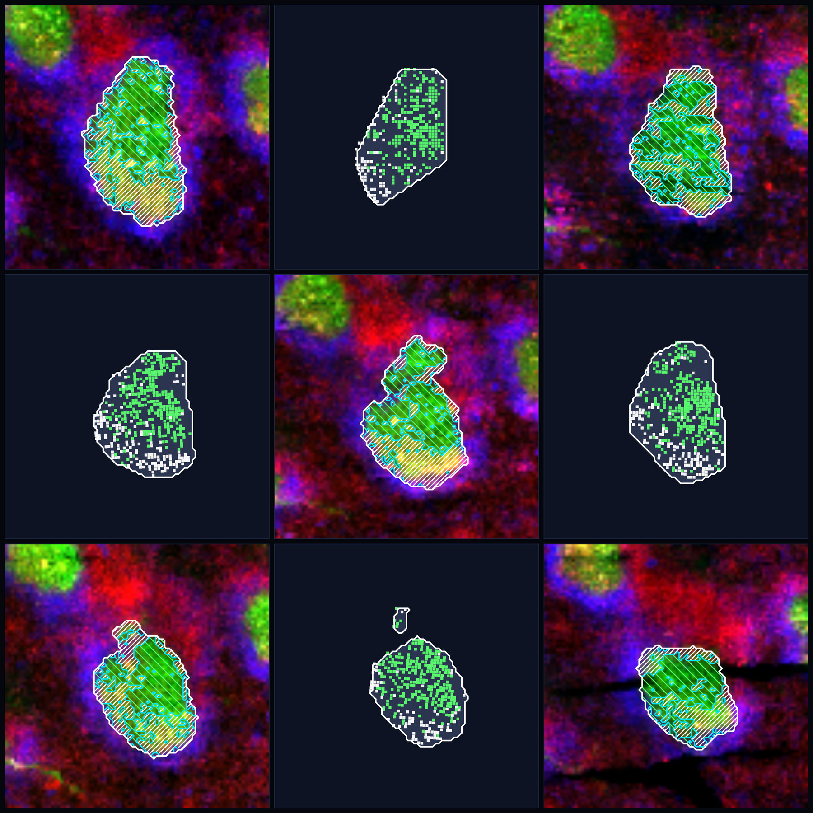

# Flat figures

A rendered volume is persuasive whether or not the segmentation under it is any
good, so these draw the same GCs flat, one 3x3 grid of the nine sections per GC.

| Script | Figure |
|---|---|
| `plot_gc_closeup.py` | one GC across the nine sections, IF stain in true colour, GC outline and the previous section ghosted |
| `plot_dzlz_split.py` | the same close-up with the dark/light-zone split drawn over the stain it was derived from |
| `plot_dzlz_all.py` | `plot_dzlz_split.py` over every GC of both replicates, plus a manifest |

One germinal centre, `plot_dzlz_split.py`, nine sections in cutting order. The five IF
panels carry the stain underneath — CD4 red, GL7 green, IgD blue — with the dark zone
hatched cyan and the light zone hatched white; the four Stereo-seq panels have no image
to show, so they carry the per-bin zone calls directly. The split is being asked to agree
with a red gradient it never saw, across a modality boundary, on sections 10 µm apart.

On the IF panels the stain is left untouched and the two zones are marked by
hatching rather than a colour wash: the question being asked is whether the
split follows CD4, and a solid fill hides exactly that. The hatch *direction*
is what separates them, because over a red-and-green composite the two hatch
colours blend into the stain.

`plot_dzlz_all.py` writes a `manifest.csv` alongside the figures giving, per GC,
how many of the nine planes it appears on and on how many IF planes the median
split could be made at all. Sort by those before looking through them: a GC
present on two planes produces a mostly empty figure, and one too small on every
IF plane produces an outline with no hatching.

## What a plain close-up looks like

`plot_gc_closeup.py`, same layout without the zone split. The white outline is the GC on
that section and the dashed outline is the same GC on the section before, so growth and
shrinkage read straight off the panel. Where the GC is absent the panel says what occupies
its footprint instead — "nothing" and "the neighbouring GC" are very different problems,
and a figure that only said "absent" would hide which one you have.
