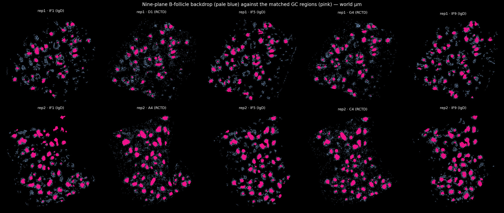
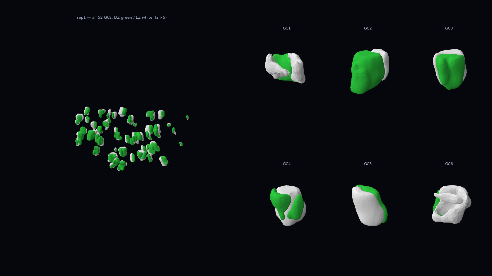

# Viewer layers

Builders for the optional layers the nine-section viewer can carry, and for the
four-section RCTD atlas that shares its coordinate frame. `gcalign` itself needs
none of these: it draws GC columns from the registration alone, and each layer
below is skipped if its input file is absent.

| Script | Produces | Read by |
|---|---|---|
| `extract_rctd.R` | per-section cell-type weights from the RCTD `SpatialExperiment` objects | everything below |
| `build_follicle_layer.py` | `follicle_points.npz` — B-follicle backdrop, IgD on the IF planes and the RCTD follicular-B call on the Stereo-seq planes | `gcalign.viewer` |
| `build_dzlz_layer.py` | `dzlz_points.npz` — dark/light zone points with a curated GC id per point | `gcalign.viewer` |
| `build_zone_blocks.py` | `zone_blocks.npz` — one solid dark-zone and one solid light-zone mesh per GC | `gcalign.viewer` |
| `build_if_images.py` | `if_images.json` — full-resolution IF photographs with GC outlines, for the side panel | `gcalign.viewer` |
| `build_rctd_four_slice.py` | a standalone four-section RCTD atlas HTML | — |
| `finish_all.sh` | runs the above and regenerates both replicates' viewers | — |

## What the layers look like

The B-follicle backdrop across the nine planes — IgD on the IF planes, the RCTD
follicular-B call on the Stereo-seq planes, drawn in one colour so it reads as a single
structure rather than two datasets. A GC column floating in empty space cannot be judged;
against the follicles it sits in, a shift between sections is visibly either the GC moving
or the registration drifting.

`build_zone_blocks.py` re-cut each GC into one dark-zone and one light-zone solid. The two
meshes tile the GC exactly because they are one continuous field split at a single
threshold, not two independent thresholds.

## Paths

Every script carries a `/path/to/...` placeholder where this project used a
cluster path. Set them before running:

| Placeholder | What it is |
|---|---|
| `/path/to/nine_section_output` | the `output_dir` from your `gcalign` config |
| `/path/to/rctd_work` | where `extract_rctd.R` wrote its weight tables |
| `/path/to/rctd_rep1`, `/path/to/rctd_rep2` | the RCTD result directories |
| `/path/to/rep1_isotype`, `/path/to/rep2_isotype` | the curated four-section GC matching, for the atlas ids |
| `/path/to/spateo-env/bin/python` | an interpreter with `pyvista`, `scikit-image`, `shapely` |

## Two things worth knowing before using these

**The DZ/LZ call on the IF planes is a median split, deliberately.** Inside each
registered GC the area is split on CD4 at that GC's own median. A sweep over
smoothing (sigma 0, 1.2, 2.5 px) and split point (50/50 through 80/20) showed
smoothing costs up to 15 points of agreement against the neighbouring
Stereo-seq sections while the split point changes almost nothing, so the
least-parameterised option won on the data rather than on taste.

**The blocks are a partition, the points are not.** `build_dzlz_layer.py`
thresholds the two zones independently, so its two point clouds can overlap and
can leave gaps. `build_zone_blocks.py` instead splits one continuous field, so
the two solids tile the GC. They are two readings of the same measurement and
the viewer switches between them rather than showing both at once.
